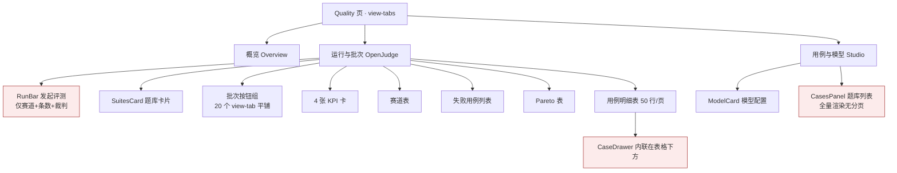
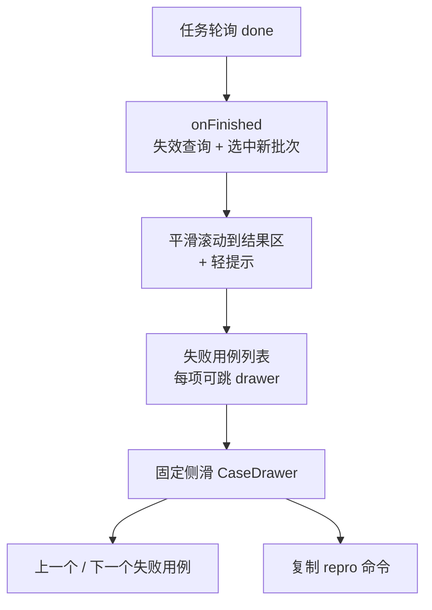
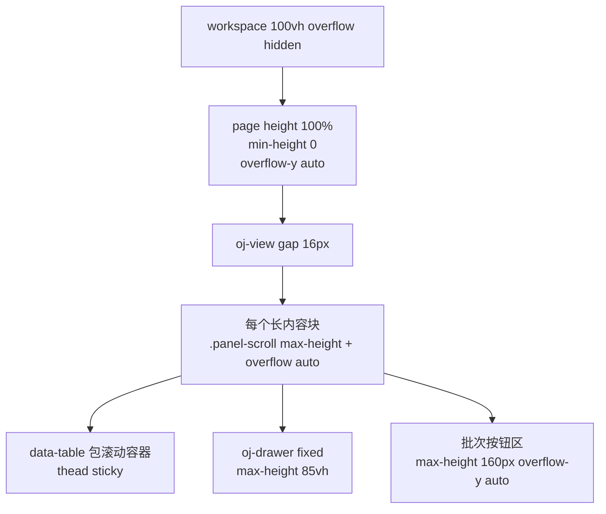
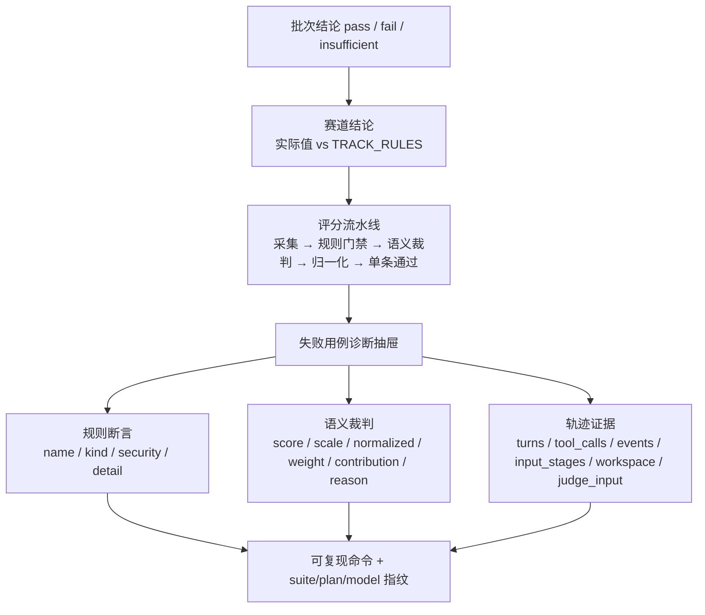
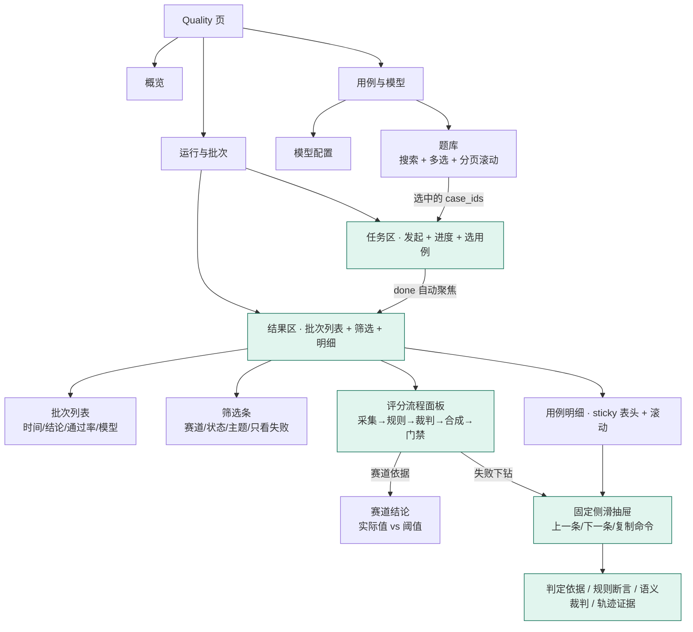

# SPEC-0008：质量前端可用性改造

- 状态：待评审（仅方案，未实施、未提交）
- 范围：`web/src/pages/quality/**`、`web/src/styles.css`（OpenJudge 段）、
  `web/src/api/client.ts`、`web/src/types/openjudge.ts`；P0-1 另需
  `src/devops_agent/openjudge/{api,service,casestore}.py`；P0-4 另需
  `src/devops_agent/openjudge/{api,store,grade,report,run}.py`
- 前置阅读：SPEC-0007（在线配置模型与用例）、`docs/wiki/Observability-and-Eval.md` §8
- 证据约定：本文所有结论均带 `文件路径:行号`，以 main `548f120` 为基线。

## 1. 结论

这些痛点不是若干独立 bug，而是同一个设计缺陷的多种表现：**质量页把"配置 → 发起 → 定位批次 → 逐条诊断"四种任务塞进一个纵向平铺的静态页面**，既没有任务分区，也没有筛选/定位/滚动与解释能力。

| 痛点 | 真根因 | 优先级 | 最小改动 |
| --- | --- | --- | --- |
| 选择测试用例不便 | 在线 run 契约只支持「单赛道 + 前 N 条」 | P0-1 | 后端加 `case_ids`，前端 RunBar 加多选 |
| 跑完查看结果不便 | `onFinished` 只换选中项不聚焦；详情是内联 div 不是抽屉 | P0-2 | 自动滚动 + 固定抽屉 + 失败用例导航 |
| 缺少滚动条 | `.page` 无高度/滚动约束，长表格与 drawer 无 max-height | P0-3 | 布局高度链 + 表格滚动容器 + 抽屉定高 |
| 看不到评分流程 / 追溯不了问题 | 证据已落库，前端只展示结论碎片；阈值和合成公式未暴露 | P0-4 | 评分流程图 + 判定依据 + 证据时间线 |
| 批次/筛选/文案 UI 不对 | 后端筛选能力未暴露、verdict 文案双源、按钮语义错用 | P1/P2 | 暴露 status/subject、统一 labels 单一来源 |

## 2. 现状证据

### 2.1 信息架构现状



所有区块 `styles.css:4715-4719` 的 `.oj-view` 用 `flex column + gap` 纵向堆砌，没有任务分区，也没有任何区块级高度约束。用户完成一个任务要线性穿过 10+ 个区块。

### 2.2 逐条证据

**P0-1 选择测试用例不便**

- `web/src/pages/quality/run/RunBar.tsx:65-87`：发起参数只有 `track` / `limit` / `judge`；`startOpenJudgeRun({ track, limit, judge })`。
- `web/src/types/openjudge.ts:171-177`：`OjRunRequest` 仅三个字段，没有用例 id 列表。
- `src/devops_agent/openjudge/api.py:185`、`service.py:44-92`：`POST /runs` → `start(track, limit)` → `load_cases(track, limit)`；`wiki §8` 明确「在线评测只到单赛道、`limit ≤ 30`」。
- 后果：题库 90 条（`SPEC-0007`），只能按赛道跑**前 N 条**。复现某一条失败用例（`OpenJudge.tsx:250` 给出的 `repro` 命令指向 `run --case`）在页面上做不到，必须整赛道重跑。

**P0-2 跑完查看结果不便**

- `web/src/pages/quality/OpenJudge.tsx:154-159`：`onFinished` 只做 `setSelected(batchId)` + 重置 offset/openCase，**不滚动、不聚焦、不提示**；跑完视图停在页面顶部 RunBar。
- `OpenJudge.tsx:39-95`、`355-357`：`CaseDrawer` 是内联 `<div className="oj-drawer">`，追加在表格**下方**。点一条用例后详情出现在表格之后，长页面里要往下找；关闭后位置丢失。
- `OpenJudge.tsx:244-253`：失败列表只列 `case_id / track / status / failed_checks / repro`，`repro` 是纯文本 `<code>`，无复制按钮，不能跳到该用例的 drawer。
- 后果：从"跑完"到"看到某条用例为什么失败"要经过 5+ 次滚动和点击，且无法连续比对多条失败。

**P0-3 缺滚动条 / 布局溢出**

- `web/src/styles.css:823-828`：`.workspace` 是 `height:100vh; overflow:hidden`；`:829-836` `.workspace-main` 有 `min-height:0`，但质量页根容器 `<div className="page">`（`Quality.tsx:19`）**没有** `height:100%` / `min-height:0` / `overflow-y:auto`。
- `styles.css:390-394`：`.data-table` 定义 `width:100%` 但**没有** `overflow-x` 包裹容器；列多时撑破 panel。对比 chat 区 `:1600-1604` 有明确的 `max-height + overflow-y:auto`。
- `styles.css:4729-4735`：`.oj-drawer` 无 `max-height` / `overflow-y`，规则失败项 + 裁判意见 + 事件多时无限拉长。
- `styles.css:4721-4727`：`.tag-row` 是 `flex-wrap`，20 个批次按钮 + 对比下拉会堆成多排，无高度上限。
- `styles.css:4805-4810`：`.oj-library-body` 两列 grid，列无独立滚动；`CasesPanel.tsx:76-92` 一次渲染全部用例（最多 90 条），左列把整页拉长。
- `CaseEditor.tsx:117-124`：textarea `rows={22}` 固定高，无 max-height。

**P0-4 评分流程不可见 / 问题不可追溯**

- 后端评分链路已经固化：`grade.py:361-376` 先跑确定性断言，`grade.py:378-388` 按 `judge` 开关决定是否进裁判，`grade.py:463-489` 按 content / instruction / tool / loop 四桶并发，`grade.py:298-341` 归一化加权，`grade.py:400-405` 得出单条通过；赛道与批次门禁在 `report.py:21-27,71-87,128-134`。这些中间态没有任何界面入口。
- 阈值和计划只存在服务进程：`grade.py:31-32` 的 `PASS_JUDGE=0.60`、`grade.py:29` 的 `PLAN_PATH`、`eval/openjudge/plan.yaml:1-27` 六个 Grader 的权重/量纲、`report.py:21-27` 的赛道规则。`api.py:143-165` 的 `/suites` 只下发 `TRACK_RULES`，前端无法解释"为什么 0.58 分失败"。
- 证据字段已落库但前端类型不完整：`store.py:39-56` 已存 `checks_json / judge_json / trace_json / events_json / input_stages_json / workspace_json`，`store.py:309-327` 详情接口会解析返回；但 `web/src/types/openjudge.ts:61-68` 的 `OjCaseDetail` 没有 `judge_norm / rule_passed / violations`，`checks` 也没有 `security`，而 `rulegate.py:17-34` 实际返回该字段。
- 前端抽屉只读三个碎片：`OpenJudge.tsx:47-92` 只列失败 checks、judge 分数/原因、事件；未使用 `trace.tool_calls`（`trace.py:28-43,88-111`）、`input_stages`（`rulegate.py:116-126`）、`workspace.states/diff`（`rulegate.py:68-113`）和 `judge_input`。
- 结论到证据没有路径：`OpenJudge.tsx:245-251` 的失败列表只有 `case_id / status / failed_checks / repro`，点不到对应 drawer；`OpenJudge.tsx:218-235` 的赛道表也没有"为什么是这个 verdict"的入口。
- 后果：用户只能看到"失败"，无法判断卡在采集、规则、安全违例、裁判分低、裁判未跑还是样本不足；定位一条失败要手动翻数据库或 `traces.jsonl`。

**P1-1 批次选择不便**

- `OpenJudge.tsx:177-192`：20 个批次渲染为 `view-tab` 按钮组，`flex-wrap` 平铺；文案只有 `#id · verdict · model`（L189），**无时间、无通过率、无用例数**。
- `OpenJudge.tsx:366-381`：对比用两个 `<select>`，`<option>` 只显示 `#id`，选的时候看不出在比哪两批。
- `styles.css:3718-3728`：`.view-tab` 本意是**视图切换** tab（`Quality.tsx:23-36` 用得正确），批次列表复用它属于语义错用。

**P1-2 后端筛选能力未暴露**

- `src/devops_agent/openjudge/api.py:66-90`：`GET /batches/{id}/cases` 支持 `track / status / subject / passed / limit / offset`。
- `web/src/api/client.ts:332-339`：`OjCaseQuery` **已定义** `status` / `subject`。
- `OpenJudge.tsx:285-312`：UI 只暴露 `track` 下拉 + `passed` checkbox；`status` / `subject` 从未使用，`fetchOpenJudgeCases` 调用（L118-125）也没传。
- 后果：能按状态和主题查，但页面上做不到；分页只有上一页/下一页（L347-354），无每页条数、无跳页。

**P2-1 verdict 文案双源且配色不分**

- `web/src/pages/quality/labels.ts:11-18` 与 `Overview.tsx:14-19` **各定义一份** `VERDICT_TEXT`，释义不同：`labels` 里 `insufficient="样本不足"`、`Overview` 里 `insufficient="样本不足，不参与发布门禁"`。
- `labels.ts:20-24` `verdictClass` 把 `insufficient / warn / cancelled` 全部映射为 `is-pending`，"样本不足"和"指标回退"视觉上无法区分——而 wiki §5 明确三态里 `insufficient` 是独立结论。

## 3. 改造方案

### P0-1 用例选择：从「前 N 条」到「精确选」


1. 契约：`OjRunRequest` 增 `case_ids?: string[]`；与 `track` 互斥（都传返回 422）。
2. 后端：`start()` 增加 `case_ids` 分支，按 id 从 casestore 取用例（复用 `casestore.get_raw`），仍守 `limit ≤ 30` 上限；`claim_run` 记录的 `total` 用实际条数。
3. 前端：RunBar 增"选择用例"入口，展开一个带搜索框的多选面板（复用题库数据 `fetchOpenJudgeLibrary`），显示"已选 N / 上限 30"；选了用例则赛道选择置灰。
4. 兼容：`case_ids` 缺省时行为完全不变（单赛道前 N 条），CLI nightly 不受影响。

### P0-2 结果查看：从「找结果」到「结果找人」



1. `onFinished` 增加 `requestAnimationFrame` 滚动到结果锚点 + 一条"批次 #N 已就绪"提示；跑完不再需要手动找。
2. `CaseDrawer` 改 `position: fixed` 右侧抽屉（宽 480px、`max-height:85vh; overflow-y:auto`、遮罩 + Esc/点遮罩关闭），脱离表格流。
3. 抽屉内加"上一个失败 / 下一个失败"导航（基于已筛出的失败用例列表），支持连续诊断不回滚。
4. 失败列表每项 `repro` 加"复制"按钮；`repro` 文案修正为对应 `--case <id>` 的正确命令（当前 `report.py:107` 生成的命令在语义裁判失败时只跑 `--no-judge`，复现不了失败）。

### P0-3 滚动与布局：建立高度链



1. `Quality.tsx:19` 的 `.page` 补 `height:100%; min-height:0; overflow-y:auto`（对齐 chat 容器 `styles.css:1062-1064` 的做法）。
2. 新增 `.table-scroll { max-height: 420px; overflow: auto; }`，所有 `data-table` 外层包裹；`thead th { position: sticky; top: 0; }`。
3. `.oj-drawer` 改固定抽屉；`.tag-row` 的批次按钮区改 `--batch-strip` 变量控制 `max-height:160px; overflow-y:auto`。
4. `.oj-library-body` 左列加 `max-height:60vh; overflow:auto`；textarea 改 `max-height:50vh; resize:vertical`。

### P0-4 评分流程可见化与问题追溯

目标：把"结论"展开成"证据链"。用户从批次结论出发，能一路下钻到赛道门禁、单条用例的分数构成、具体断言 / 裁判 / 工具调用，而不是只看到一个红绿 pill。



**1. 后端补"判定依据"契约（单一来源）**

1. 新增 `GET /api/openjudge/scoring-config`，只读 `grade.load_plan()` / `grade.PASS_JUDGE` / `report.TRACK_RULES`，返回：
   ```ts
   interface OjScoringConfig {
     plan: { name: string; sha: string; judges: { key: string; grader: string; weight: number; scale: [number, number] }[] };
     pass_judge: number;
     track_rules: Record<string, { pass_rate: number; judge?: number; min_n: number; max_violations?: number }>;
   }
   ```
   阈值、权重、量纲必须来自执行它们的同一份 Python 常量（`grade.py:29-32`、`plan.yaml:1-27`、`report.py:21-27`），**禁止前端复制 `0.60 / 0.35` 字面量**。`api.py:143-165` 的 `/suites` 继续只管题库阈值，避免两个接口语义重叠；前端按 `plan_sha` 缓存配置。
2. `oj_cases` 增加 `judge_norm REAL` / `rule_passed INTEGER` / `violations INTEGER`；`store.insert_case`（`store.py:164-197`）从 `result` 原样写入，`store.get_case`（`store.py:309-327`）解析返回。历史行在 `get_case` 层用 `checks` / `judge` 回退，回退公式必须与 `grade._total`（`grade.py:333-341`）一致；**只在后端回退，不让 UI 重算**。`init_db`（`store.py:113-115`）用 `PRAGMA table_info` + `ALTER TABLE` 做幂等迁移。
3. "缺项显式化"：在 `grade.py:392-489` 给未执行的 Grader 写 `judge[key] = { status: 'skipped', reason }`，而不是让它缺席。跳过原因至少覆盖 `judge=false`、`rule_failed`（门禁失败不进裁判）、`no_judge_spec`、`no_reference_response`、`confirm_turn`、`no_expected_tool`、`loop_need_2_calls`。`_total`（`grade.py:333-341`）只统计有 `normalized` 的项，因此不影响现有分数。
4. `report._verdict`（`report.py:71-87`）在 `summary.tracks[track]` 增加 `reasons: [{ code, actual, threshold, message }]`，覆盖 `sample_short / judge_missing / pass_rate_below / judge_below / violations_above`；按钮上"为什么未达标"直接渲染这些原因，前端不自行比较阈值。
5. `OjCaseDetail`（`web/src/types/openjudge.ts:61-68`）补 `scoring` 与 `checks[].security`：
   ```ts
   interface OjScoring {
     rule_passed: boolean;
     violations: number;
     judge_norm: number | null;
     pass_judge: number;
     passed: boolean;
     formula: string;
     failure_type: 'runtime' | 'security' | 'rule' | 'judge_score' | 'judge_skipped';
   }
   ```
   `failure_type` 由后端按固定优先级判定：安全违例 → 执行异常 → 规则失败 → 裁判未跑 → 裁判分低。保留现有 `judge` map 作为兼容视图，新增字段只增不删。

**2. 新增"评分流程"面板**

新增 `web/src/pages/quality/run/ScoreFlow.tsx`，放在 `OpenJudge.tsx:212-236` 的赛道表之后、失败列表之前，五个阶段横向排列：

1. **采集**：用例数、终态分布（success / failed / parked / timeout）、P95 延迟与 tokens（`report.py:137-157`）。
2. **规则门禁**：已跑断言数、失败断言数、规则失败用例数、安全违例数；安全违例单独红色 chip，不并入均分（`rulegate.py:268-275`）。
3. **语义裁判**：`judge_n`、六个 Grader 的 `scored / skipped` 状态与跳过原因、裁判模型名（`run.py:153-165` 的 `summary.meta.judge_model`）。
4. **归一化合成**：展示公式 `Σ(normalized × weight) / Σweight`（`grade.py:298-341`）和 `judge_norm` 分布，标注 `PASS_JUDGE` 来源为后端配置。
5. **门禁判决**：每个赛道显示 `实际值 → 阈值 → verdict` 的依据行（`report.py:21-27,71-87`），批次总判定由赛道结论与违例合成（`report.py:128-134`）。

每个阶段可点击：点"规则门禁"打开抽屉的规则 Tab，点"语义裁判"打开裁判 Tab，点"门禁判决"滚动到赛道表并高亮对应赛道。批次为 `fail` / `insufficient` 时默认展开，`pass` 时默认折叠（`OpenJudge.tsx:214-217` 的 verdict pill 旁加"依据"按钮）。

**3. 诊断抽屉改成"判定依据 + 四类证据"**

在 P0-2 的固定抽屉内加 Tab，替换 `OpenJudge.tsx:39-95` 现在只有三段列表的实现：

| Tab | 内容 | 事实来源 |
| --- | --- | --- |
| 判定依据 | 五阶段 stepper，逐阶段显示 pass / fail / skipped 与原因；底部给出 `passed` 的完整算式 | `scoring` + `scoring-config` |
| 规则断言 | **全部** checks，按 `kind` 分组，不再只列失败项；`security=true` 单独标记 | `rulegate.py:17-34,251-265` |
| 语义裁判 | 六个 Grader 一行一项：`score / scale / normalized / weight / contribution / reason / status`；skipped 项显示原因 | `grade.py:408-489` + `plan.yaml` |
| 轨迹证据 | 时间线：turns → tool_calls（name/args/state/result_excerpt）→ events → input_stages → workspace（states/diff/sha256）→ judge_input 快照 | `trace.py:28-111` |

证据区遵守两条约束：长文本（工具结果、diff、裁判输入）默认折叠，仅展示前 200 字摘要并提供"展开原文"；原始 JSON 用等宽只读块展示，不提供编辑。每条证据带"定位到断言/裁判"的反向链接，例如点 `tool_args:Grep` 直接跳到对应工具调用。

**4. 失败定位路径与分类**

失败列表（`OpenJudge.tsx:245-251`）每条增加"定位"按钮，按 `failure_type` 直接打开抽屉并预选 Tab；"复制复现命令"沿用 P0-2 修正后的命令。分类表：

| failure_type | 判定条件 | 用户先看到什么 | 下一步证据 |
| --- | --- | --- | --- |
| `security` | 存在 `security=true && !passed` | 安全违例 chip + 违例项 | 禁止文本命中的工具入参 / final_text |
| `runtime` | `trace.status != success` | 采集阶段失败 + `error` | events 时间线 |
| `rule` | 存在 `!passed` 的普通 check | 失败断言名 + kind + detail | 对应工具调用 / 输入阶段 / 文件状态 |
| `judge_skipped` | `judge_norm == null` 或非安全原因未跑裁判 | skipped Grader 及原因 | judge 开关、模型配置、指纹 |
| `judge_score` | `judge_norm < pass_judge` 且无规则失败 | 低分 Grader + reason | judge_input 与轨迹证据 |

批次层另有 `insufficient` 路径：赛道表依据行展示 `n / min_n` 或 `judge_avg == null`，与单条用例失败明确区分，避免把"没数据"误读为"模型答错"（`report.py:71-87`）。

### P1-1 批次选择：从按钮堆到可读列表

1. 批次区改**紧凑表格**或可搜索下拉：每行显示 `#id · 完成时间 · verdict · 通过率 · 模型 · 用例数`；默认选中最新，支持按 verdict 过滤（后端 `api.py:46` 已支持 `verdict` 参数，前端 `fetchOpenJudgeBatches` 未传）。
2. 对比页两个 `<select>` 的 `<option>` 改为 `#id · 时间 · verdict · 通过率`，让选择可读。
3. 批次按钮不再复用 `.view-tab`，改用专用 `.batch-chip`。

### P1-2 暴露筛选能力

1. `fetchOpenJudgeCases` 调用补齐 `status` / `subject`（`OjCaseQuery` 已有字段），UI 加状态下拉 + 主题搜索框。
2. 分页增强：`OjCaseQuery` 增 `pageSize`，UI 显示"第 X/Y 页，共 N 条"、每页条数选择、首页/末页跳转。
3. 筛选条件写入 URL query（`useSearchParams`），刷新/分享不丢状态。

### P2-1 统一 verdict 单一来源

1. 删除 `Overview.tsx:14-19` 的本地 `VERDICT_TEXT`，统一 import `labels.ts`。
2. `verdictClass` 拆出 `is-insufficient` / `is-warn` / `is-cancelled` 三档样式，与 `wiki §5` 三态语义对齐。
3. `labels.ts` 提供 `verdictText(verdict, verbose)` 一个函数两档文案，消除双源。

## 4. 目标态信息架构



任务分区把"发起"和"看结果"拆成两个有明确衔接的区域，题库选中的用例可回流到发起区，形成闭环。评分流程面板是结果区的"解释层"：批次结论不是终点，而是进入证据链的入口。

## 5. 验收标准

| 编号 | 验收场景 | 通过条件 |
| --- | --- | --- |
| AC-1 | 复现单条失败用例 | 在题库选 1 条 case_id → 发起 → 批次只含该条 |
| AC-2 | 跑完定位结果 | 点击开始后不手动滚动即可看到新批次结论区 |
| AC-3 | 连续诊断失败 | 抽屉内点到下一条失败用例无需关闭/回滚 |
| AC-4 | 窄屏 1280×720 | 批次列表、用例明细、编辑区各自滚动，页面无横向溢出 |
| AC-5 | 按主题筛选 | 输入 subject 关键字，明细表只显示匹配项，刷新后条件保留 |
| AC-6 | verdict 三态 | pass/fail/insufficient 呈现三种可区分的配色与文案 |
| AC-7 | 向后兼容 | 不传 `case_ids` 的在线 run 行为与改造前逐字段一致 |
| AC-8 | 看评分流程 | 任一批次都能看到五阶段流水线；`fail` / `insufficient` 默认展开，每阶段显示实际值与判定依据 |
| AC-9 | 看懂单条分数 | 打开任一进入过裁判的用例，能看到六个 Grader 的 score/scale/normalized/weight/contribution 与合成公式 |
| AC-10 | 追溯裁判分失败 | 给定一条 `judge_score` 失败用例，能在 3 次点击内定位到低分 Grader、reason 和对应轨迹证据 |
| AC-11 | 区分未判分 | `judge=false`、规则失败未进裁判、无 `judge` 声明、样本不足四种情况展示为不同原因，不再统一显示"未跑语义裁判" |
| AC-12 | 安全违例单列 | B 赛道违例以独立 chip 展示，且不显示在语义质量均分里 |
| AC-13 | 阈值单一来源 | 修改 `plan.yaml` 权重或 `TRACK_RULES` 后，前端不改代码即显示新阈值与文案 |
| AC-14 | 历史批次兼容 | 缺新增字段的老批次仍能打开抽屉，回退计算出的分数与 `grade._total` 一致且不报错 |

## 6. 非目标与风险

- 非目标：不做拖拽排序、不做用例 diff 可视化、不做多人协作选题（沿用 ADR-0001 单机单用户）。
- 风险 1：P0-1 触及 `POST /runs` 契约，须同步更新 `tests/unit/test_openjudge_online.py` 与 `web` 类型测试；契约变更不可破坏 CLI。
- 风险 2：`.page` 高度链改动影响所有使用 `.page` 的页面（Runs / Cost / Dashboard），须回归这些页的滚动行为，必要时只在 Quality 根容器加修饰类限定作用域。
- 风险 3：`repro` 命令修正依赖 `report.py` 侧生成逻辑，若改前端文案而不改后端会再次双源——应在后端 `report._failures` 一次性修正，前端只展示。
- 风险 4：P0-4 需要给 `oj_cases` 加列。必须幂等迁移并保留老行回退，否则历史批次打开即 500；迁移前后各跑一次 `tests/unit/test_openjudge_store.py`。
- 风险 5：Grader 缺项若继续用"键不存在"表示，前端无法区分"不适用"和"数据丢失"。必须先改后端写 `status='skipped'`，再改前端展示，顺序不能反。
- 风险 6：轨迹证据体积大（工具结果 / diff / judge_input）。默认只渲染摘要，原始内容折叠；避免一次把 50 条用例的全文塞进 DOM。

## 7. 实施顺序建议

1. P0-3（布局/滚动，纯前端、零契约风险，收益立竿见影）
2. P0-2（结果查看，纯前端）
3. P0-4a（后端：`scoring-config` + 存储字段/幂等迁移 + skipped 显式化 + verdict reasons）
4. P0-4b（前端：评分流程面板 + 抽屉四 Tab + 失败定位；依赖 P0-4a 契约）
5. P1-1 / P1-2 / P2-1（纯前端 + labels 收敛）
6. P0-1（跨前后端契约，放最后，单独一个 PR 便于回归）

每一步独立 PR、独立 CI；P0-1 与其余前端改动分开，避免契约问题污染纯 UI 改动。P0-4 必须后端先行：先有可解释的判定依据，再接前端展示，避免 UI 自己造一套分数口径。
