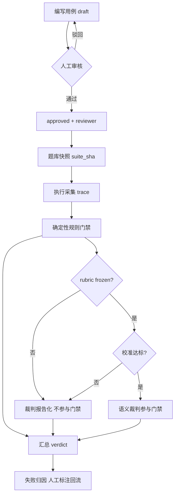
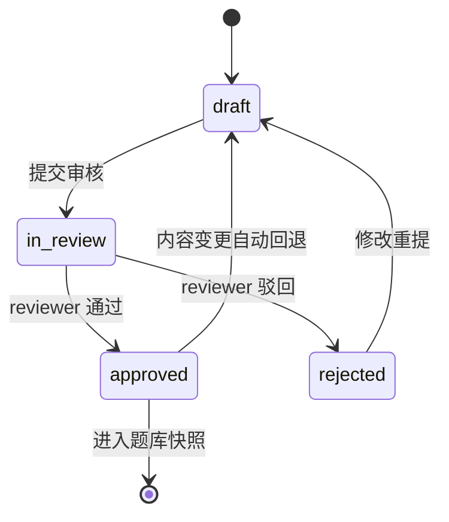
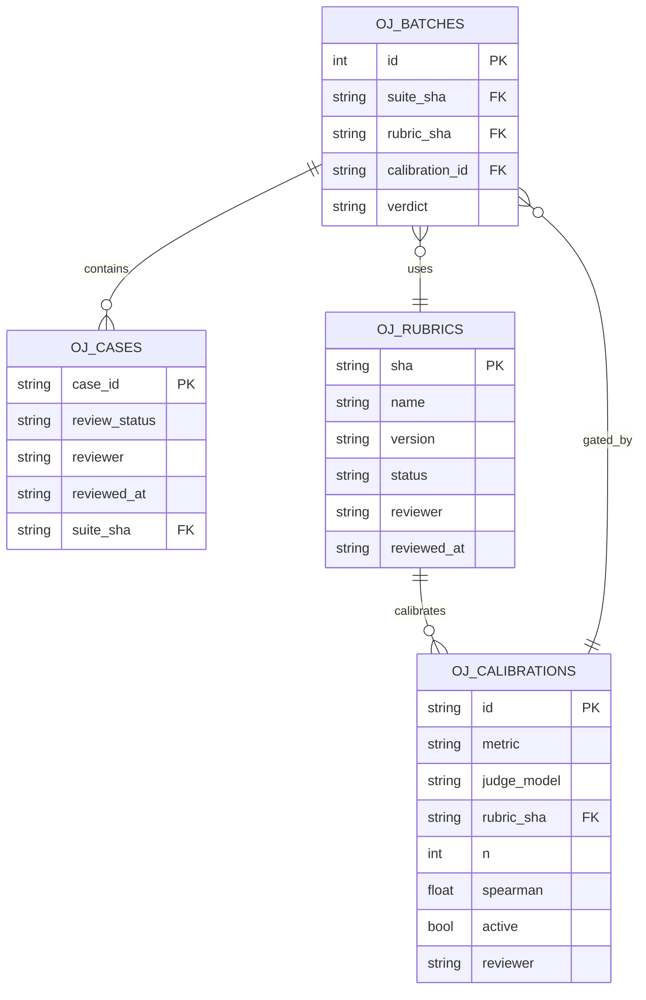

# SPEC-0009：评测可信度门禁与评审流程

- 状态：已实施（分支 `feat/eval-credibility-gates`，合并提交见 git log）；P1 评审界面不在本期范围
- 基线：`main d0d2fc6`
- 范围：`src/devops_agent/openjudge/**`、`eval/openjudge/**`、`web/src/pages/quality/**`、`web/src/api/**`、`web/src/types/**`、`docs/specs/0008-quality-frontend-ux.md`
- 前置阅读：`docs/specs/0006-agent-eval-quality-gate.md` §4.4 / §6.1、`docs/specs/0007-eval-model-and-cases-online.md`、`docs/wiki/Observability-and-Eval.md` §4–§5、SPEC-0008
- 证据约定：本文所有现状结论均带 `文件路径:行号`，基线为 `d0d2fc6`。设计建议与既有事实分开写，不把“应该有”写成“已有”。
- 前端实施约束：凡修改 `web/**`，先读 `skills/.seed/modern-web-guidance/SKILL.md` 并按 `AGENTS.md:126-140` 的 search → retrieve → 合规校验 → 披露流程执行。

## 1. 结论

当前项目的评测**工程链路基本正确**：真跑、轨迹落盘、规则门禁、语义裁判、三态结论、失败下钻都已落地。问题不在“没做评测”，而在**可信度链条断了三截**：

1. **流程可见性**：评分流程面板已经实现（`web/src/pages/quality/OpenJudge.tsx:317-324`），但只在「运行与批次」页出现；通过批次默认折叠（`OpenJudge.tsx:321`），用户停在「概览」页时会以为没有流程。方案文档状态也仍写“未实施、未提交”（`docs/specs/0008-quality-frontend-ux.md:3`），进一步造成认知偏差。
2. **用例审核缺失**：用例来自仓库 JSONL，例如 `eval/openjudge/cases/a-repo.jsonl:1` 带 `owner` / `provenance`，没有 `reviewer` / `review_status`；`Case` 数据结构也没有审核字段（`src/devops_agent/openjudge/benchmark.py:106-122`）。在线编辑只标记 `source=overlay`（`src/devops_agent/openjudge/casestore.py:196-203`），没有任何审批流转。
3. **裁判不可信**：rubric 由 AI 生成后写为 `draft`、`reviewer=""`（`src/devops_agent/openjudge/rubric.py:55-84`、`eval/openjudge/rubrics/repo_qa_quality/v1/meta.json:4-5`）；`frozen()` 虽已定义（`rubric.py:48-52`），但判分构造只传模型和语言，未注入 rubric（`src/devops_agent/openjudge/grade.py:202-228`）。SPEC-0006 要求的 Spearman ≥ 0.7 校准（`docs/specs/0006-agent-eval-quality-gate.md:354-362`）也没有实现。

因此建议的修改不是重做评测，而是补三道门禁：**用例审核门禁、rubric 冻结门禁、裁判校准门禁**，并把评分流程入口固定到用户一定能看到的位置。

## 2. 现状证据

| 编号 | 结论 | 证据 | 判断 |
| --- | --- | --- | --- |
| E1 | 评分流程 UI 已实现 | `web/src/pages/quality/OpenJudge.tsx:317-324`；五阶段定义 `web/src/pages/quality/run/ScoreFlow.tsx:24-61` | 已有 |
| E2 | 流程入口受页签与 verdict 限制 | `OpenJudge.tsx:321`：`defaultOpen={summary.verdict !== 'pass'}` | 部分 |
| E3 | 方案文档状态过期 | `docs/specs/0008-quality-frontend-ux.md:3` 仍写“待评审（仅方案，未实施、未提交）” | 错误 |
| E4 | 用例无审核字段 | `benchmark.py:106-122`；`eval/openjudge/cases/a-repo.jsonl:1` | 缺失 |
| E5 | 在线编辑无审批 | `casestore.py:196-203` 仅写覆盖层并标记 `source` | 缺失 |
| E6 | rubric 是 AI 生成 draft | `rubric.py:123-177`；`meta.json:4-5` | 部分 |
| E7 | rubric 未接入判分 | `grade.py:202-228` 构造 Grader 时没有 rubric 参数；`frozen()` 无调用方 | 缺失 |
| E8 | 校准要求未实现 | `docs/specs/0006-agent-eval-quality-gate.md:354-362` 只有设计，无表 / API / CLI / UI | 缺失 |
| E9 | 已有数据库表可复用 | `oj_rubrics` 已有 `status` / `reviewer`（`store.py:63-72`）；`oj_cases` 已有评分解释列（`store.py:41-61`） | 可复用 |
| E10 | 真实执行链路正确 | `docs/wiki/Observability-and-Eval.md:97-99`：`run` 真跑落轨迹，`grade` 可重判 | 保持 |

## 3. 目标与非目标

### 3.1 目标

- 任何进入发布门禁的用例，必须有可追溯的人工审核 record。
- 任何参与语义裁判的 rubric，必须是 `frozen` 且有 reviewer。
- 任何参与门禁判定的裁判指标，必须有有效校准记录；否则只能报告，不能拦截。
- 用户在质量页任意页签都能找到评分流程入口，并能从结论下钻到证据。
- 文档状态与代码状态一致，不再出现“已实施却写未实施”。

### 3.2 非目标

- 不重做评测执行引擎，不替换 `devops_agent.openjudge`。
- 不在本期实现完整权限系统；审核人先用字符串 record，不接登录态。
- 不引入新的 LLM 裁判框架，不改 `plan.yaml` 的六维权重。
- 不自动把线上 Bad Case 变成用例；回流仍走人工确认，规则见 `docs/specs/0006-agent-eval-quality-gate.md:270-275`。

## 4. 目标链路

三道门禁的落点：

- G1 用例审核：发生在 `validate --strict` 与 `POST /runs` 之前。
- G2 rubric 冻结：发生在语义裁判初始化之前。
- G3 裁判校准：发生在 verdict 合成之前，只影响裁判是否参与门禁，不影响报告展示。

## 5. 详细需求

### 5.1 P0-1 用例审核与冻结

#### 5.1.1 数据字段

在 `Case`（`benchmark.py:106-122`）与 JSONL 顶层增加四个字段：

| 字段 | 类型 | 取值 | 说明 |
| --- | --- | --- | --- |
| `review_status` | str | `draft` / `approved` / `rejected` | 默认 `draft` |
| `reviewer` | str | 任意非空字符串 | 审批人 record，不接登录态 |
| `reviewed_at` | str | ISO 8601 | 审批时间 |
| `review_note` | str | 文本 | 可空；记录审批意见 |

设计选择：**冻结以题库快照表达，不额外增加 per-case frozen 布尔值**。批次已记录 `suite_sha`（`src/devops_agent/openjudge/store.py:28`），审核通过的用例集合通过该 sha 固化，避免两套“冻结”语义。

#### 5.1.2 状态机

`review_status` 字段本身不存 `in_review`，该状态由“提交审核但尚无决定”的审核记录表达；若不想引入审核记录表，可把 `in_review` 直接作为第四种取值。此为决策点 D1。

#### 5.1.3 行为约束

- `benchmark.validate(..., strict=True)`：任何 `review_status != approved` 的用例产生 error，见现有 strict 入口 `cli.py:219-228`。
- `POST /api/openjudge/runs` 传 `case_ids` 时，未审核 id 返回 422；该参数已存在于 `api.py:204`、`api.py:212-221`。
- `service._select_cases()` 在取用例后统一做审核校验，避免在 CLI / HTTP 两处重复写规则。
- `casestore.save()`（`casestore.py:196-203`）检测到题面、`expected`、`judge`、`fixture`、`turns` 任一变化时，把 `review_status` 重置为 `draft`；只改 `review_note` 不触发。
- 题库覆盖层与仓库题库都执行同一校验；不因为 `source=overlay` 而放宽。

### 5.2 P0-2 rubric 冻结与接入判分

#### 5.2.1 生命周期

- `rubric generate` 继续产出 `draft`，见 `rubric.py:123-177`；不自动冻结。
- 新增 `rubric approve --name <name> --version <version> --reviewer <name>`：把 `meta.json` 的 `status` 改为 `frozen`，写 `reviewer` / `reviewed_at`，重算 sha。
- 复用 `oj_rubrics` 已有列 `status` / `reviewer`（`store.py:63-72`），新增 `reviewed_at` 列，通过幂等迁移补齐。
- `rubric verify`（`cli.py:193-196`）输出 status / reviewer / sha，供 CI 与人工核对。
- `frozen()`（`rubric.py:48-52`）必须被调用：判分初始化时若 plan 声明了 rubric 但状态非 frozen，直接 `ConfigError` 或把裁判标为 skipped。二选一见 D3。

#### 5.2.2 接入判分

`_build_grader()`（`grade.py:202-228`）当前只传 `model` 与 `language`。建议：

1. `plan.yaml` 增加可选 `rubric` 字段，形如 `correctness.rubric: repo_qa_quality@v1`。
2. 加载 plan 时解析 rubric name/version，检查 `frozen()`。
3. 构造 Grader 时注入 rubric 条目。**具体注入方式必须先做依赖 API 调研**：核对 `py-openjudge==0.2.5` 各 Grader 是否接受 `rubrics` / `kwargs`，不能凭类名推断。若不支持，则本期只记录 `rubric_sha` 并冻结，不声称“rubric 已生效”。
4. 批次 meta 已有 `rubric_sha` 字段（`store.py:30`），填空的问题本期一并解决：有 rubric 时写真实 sha，无 rubric 时保持空并在 verdict 中给出 `rubric_missing` 原因。

### 5.3 P0-3 裁判校准门禁

#### 5.3.1 数据模型

新增 `oj_calibrations` 表，并在 `oj_batches` 增加 `calibration_id`：

`oj_calibrations` 记录的是“某个裁判指标 + 某个模型 + 某个 rubric 版本”的校准结论，设计依据为 `docs/specs/0006-agent-eval-quality-gate.md:356-361`。

#### 5.3.2 判定规则

- 有效校准：`active=true` 且 `n >= 100` 且 `spearman >= 0.7`。
- 无有效校准时：裁判分照常计算并展示，但不进入 `passed` 判定；批次 verdict 增加 `judge_uncalibrated` 原因，默认结论 `insufficient`。
- 校准过期条件：rubric sha、judge model、prompt template 任一变化，见 `docs/specs/0006-agent-eval-quality-gate.md:360-361`。
- P0 只做 CLI 导入：`python -m devops_agent.openjudge calibration import --file <json>`，不做前端标注页；前端只展示校准状态与过期原因。

### 5.4 P0-4 评分流程固定入口与文档纠错

- 在质量页顶部视图切换旁增加常驻按钮「查看评分流程」，点击后切到「运行与批次」并滚动到 `ScoreFlow`，同时写入 URL query `focus=scoreflow`。
- `Overview.tsx` 的结论卡增加同名入口，避免出现“只有在运行页才有”的隐藏知识。
- `ScoreFlow` 在 `pass` 批次仍可折叠，但常驻按钮与「展开依据」必须可见；`insufficient` / `fail` 继续默认展开，保持 `OpenJudge.tsx:321` 的现有行为。
- 修正 `docs/specs/0008-quality-frontend-ux.md:3`：状态改为“已实施，PR #104，合并提交 `5fb60d1`”，补一节“实施差异”说明实际实现与方案的偏差。
- 所有 `web/**` 修改按 `AGENTS.md:126-140` 先走 modern-web-guidance skill。

### 5.5 P1 评审与回流界面

- 「待审核用例」队列：列出 `draft` / `rejected`，支持通过、驳回、查看 diff。
- 「rubric 冻结」页：展示 status / reviewer / sha / 条目，支持 approve。
- 「裁判校准」页：展示 n、Spearman、分歧 Top-N；人工标注入口留到 P2。
- 「回归候选」页：按 `docs/specs/0006-agent-eval-quality-gate.md:270-275` 做 approver 审核后入 `regression` 分层。

## 6. API 与 CLI 变更

| 层 | 变更 | 说明 |
| --- | --- | --- |
| CLI | `validate --strict` 增强 | 未审核用例报 error；输出审核摘要 |
| CLI | `rubric approve` 新增 | draft → frozen，写 reviewer / reviewed_at |
| CLI | `calibration import` 新增 | 导入校准 JSON，写 `oj_calibrations` |
| API | `POST /api/openjudge/cases/{id}/review` 新增 | body：`decision` / `reviewer` / `note`；复用 `api_edit.py:85-114` 的用例编辑路径风格 |
| API | `GET /api/openjudge/calibration` 新增 | 返回当前生效校准状态，供 ScoreFlow 展示 |
| API | `POST /runs` 增强 | 未审核 `case_ids` 返回 422，见 `api.py:204-221` |
| 前端 | Quality 顶部与 Overview 增加流程入口 | 固定可达，URL query 持久化 |
| 前端 | `OjBatchSummary` 增加校准与审核字段 | 类型源在 `web/src/types/openjudge.ts` |

## 7. 兼容与迁移

- 历史 90 条用例没有审核字段。建议批量导入为 `review_status=approved`、`reviewer=legacy-import`、`review_note="历史题库批量导入，待逐条复核"`，同时在质量页显示“历史题库待复核”横幅。此为 D5，需拍板。
- 历史批次没有 `calibration_id`，统一显示 `legacy_unknown`，不重写旧 verdict。
- `oj_rubrics` 现有行 `status=draft` 保持不变；在 D3 确定前不自动冻结。
- 新增列统一走 `migrations.py` 模式（`src/devops_agent/openjudge/migrations.py`），用 `PRAGMA table_info` + `ALTER TABLE`，重复执行安全。
- 文件行数与复杂度门禁沿用现状：单文件 ≤ 500 行、radon CC ≤ 10；必要时拆 `review.py` / `calibration.py`，与 `explain.py` / `migrations.py` 的拆法一致。

## 8. 验收标准

| 编号 | 验收点 |
| --- | --- |
| AC-1 | `validate --strict` 对任意 `review_status != approved` 的用例返回非零退出码并列出 id |
| AC-2 | `POST /runs` 带未审核 `case_ids` 返回 422，且不创建 run 记录 |
| AC-3 | `rubric generate` 产出 draft；`rubric approve` 后 meta 为 frozen、reviewer 非空、sha 变化 |
| AC-4 | plan 声明 rubric 但未 frozen 时，语义裁判不启动或标 skipped，行为与 D3 一致 |
| AC-5 | `spearman < 0.7` 或 `n < 100` 时，裁判分可见但不进入 passed，批次原因含 `judge_uncalibrated` |
| AC-6 | 质量页「概览」与「运行与批次」均有「查看评分流程」入口，`?focus=scoreflow` 可直达 |
| AC-7 | `docs/specs/0008-quality-frontend-ux.md:3` 状态与合并提交更新完成 |
| AC-8 | 历史批次仍可打开，旧字段缺失不报错，显示 legacy 提示 |
| AC-9 | Python 门禁全绿；前端 lint / typecheck / test:coverage / build 全绿 |

## 9. 风险与决策点

| 编号 | 决策点 | 建议默认值 | 影响 |
| --- | --- | --- | --- |
| D1 | 是否引入 `in_review` 状态 | 不引入，审核记录独立 | 影响状态机复杂度 |
| D2 | rubric 注入方式 | 先做依赖 API 调研，不支持则只冻结不生效 | 影响“rubric 已生效”的表述是否成立 |
| D3 | 未 frozen rubric 时裁判行为 | 直接 `ConfigError`，不静默跳过 | 影响线上批次是否会失败 |
| D4 | 未校准裁判是否参与门禁 | 不参与，只报告 | 影响 verdict 口径与发布门禁严格度 |
| D5 | 历史题库回填策略 | `legacy-import` 视为 approved + 横幅提示 | 影响迁移后立即阻断还是渐进复核 |
| D6 | reviewer 是否需要登录身份 | 本期字符串，不接登录 | 影响审计强度 |

## 10. 实施顺序

1. **S1 文档与可见性**：修正 SPEC-0008 状态；加质量页流程入口。改动小、无数据语义变化。
2. **S2 用例审核**：字段、校验、API、回填策略；先 CLI 后前端。
3. **S3 rubric 冻结**：approve CLI、DB 列、plan 声明、依赖 API 调研后再决定注入范围。
4. **S4 校准门禁**：表、导入、verdict 规则、ScoreFlow 展示校准状态。
5. **S5 P1 界面**：审核队列、rubric 冻结页、校准页、回流页。

每个阶段独立 PR，门禁通过后再进入下一阶段；不把 D1–D6 的决策藏进代码里。

## 11. 实施记录

本分支实现 S1–S4 与 P0-4，S5（P1 评审与回流界面）不在本期。§2 的行号仍以基线 `d0d2fc6` 为准。

### 11.1 决策落地

| 决策 | 结论 | 代码落点 |
| --- | --- | --- |
| D1 | 不引入 `in_review`，只存 `draft/approved/rejected` | `benchmark.REVIEW_STATUSES` |
| D2 | 依赖调研确认 LLM Grader 支持 `template`，注入审核过的 rubric 条目 | `grade._rubric_template()` / `_build_grader()` |
| D3 | rubric 声明但未冻结时直接 `ConfigError`，不静默跳过 | `grade._frozen_rubric_items()` |
| D4 | 未校准裁判只报告、不进入 `passed` | `grade.grade_traces(judge_gate=...)` |
| D5 | 历史 90 条按 `legacy-import` 回填为 approved | `eval/openjudge/cases/*.jsonl`，UI 持续提示复核 |
| D6 | reviewer 本期为字符串，不接登录态 | `rubric.approve(--reviewer)` / `review_note` |

### 11.2 与方案的差异（须人工确认的部分）

1. **`plan.yaml` 尚未声明 rubric**：注入代码已就绪，但六个裁判没有任何 `rubric:` 引用，因此 `rubric_sha` 为空、rubric 当前**未参与判分**。是否声明并冻结 rubric 会改变线上评测行为（未冻结时评测直接失败），需人工拍板后再改。
2. **未导入真实校准记录**：表、CLI、门禁判定都已实现，但仓库没有 `n>=100` 的校准样本。当前批次会出现 `judge_uncalibrated` 且 verdict 降为 `insufficient`，这是刻意设计，不是故障。
3. **UI 形态**：三道门禁展示在「评分流程」面板内，不新增 P1 独立审核页；新增 `GET /api/openjudge/calibration`，`/scoring-config` 下发 `gates.review` 与 `gates.rubric`。
4. **可访问性**：展开按钮补 `aria-expanded` / `aria-controls`，门禁列表用语义 `<ul>` 并显式 `role="list"`（Safari 会抹掉 `list-style:none` + grid 的列表语义）；未改成原生 `
`，因为展开态由外部「查看评分流程」深链控制。

### 11.3 验证

- Python 评测相关单测 90 项通过；前端 lint、typecheck、342 项测试通过。
- 门禁对照：AC-1～AC-7、AC-9 由自动化测试与 CI 覆盖；AC-8 由 `calibration.checked=false` 的旧批次降级路径覆盖。
- `rubric approve` 需要人工 reviewer；未执行前 rubric 保持 `draft`，这是预期状态。
